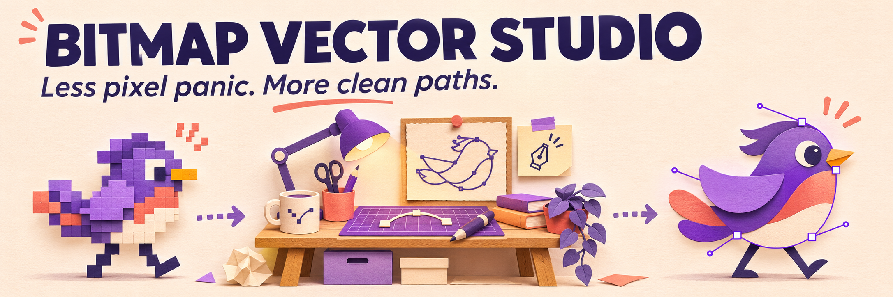
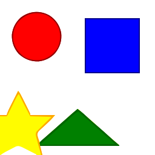
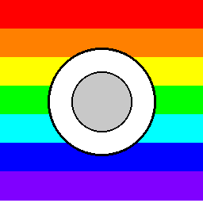
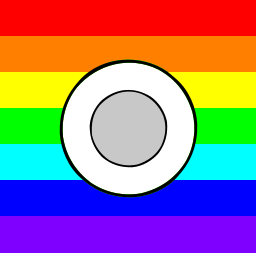

# Bitmap Vector Studio



<sub>AI で生成したコンセプト画像です。製品画面ではありません。実際の手順・実例は下記をご覧ください。</sub>

[English](README.md) · [简体中文](README.zh-CN.md) · [繁體中文（台灣）](README.zh-TW.md) · [日本語](README.ja.md) · [한국어](README.ko.md)

**VTracer** でビットマップを編集可能な SVG パスに変換します。ローカル CLI で結果を確認してから、バッチ処理や Streamlit UI を利用できます。

## リポジトリ内の実例

| 入力 PNG | 出力 SVG |
| --- | --- |
|  |  |
|  |  |

既存の再現可能なテスト画像と CLI 出力です。AI が作った製品画面ではありません。[再現手順](examples/README.md)。

## 最初の変換

Python 3.9 以降。仮想環境を推奨します。

```bash
python -m venv .venv
# macOS / Linux
source .venv/bin/activate
# Windows PowerShell: .venv\Scripts\Activate.ps1
python -m pip install -e .
vector-studio convert file examples/geometric_shapes.png --output output.svg --preset logo
vector-studio convert batch ./inputs ./outputs --preset logo --recursive
```

## プリセットの選び方

| Preset | 用途 |
| --- | --- |
| `bw` | 白黒の線画 |
| `logo` | フラットなロゴやアイコン |
| `poster` | 色数の少ないイラスト |
| `photo` | 写真。パス数は多くなる傾向 |
| `pixel_art` | ピクセルアート |
| `scan` | スキャン画像 |

## 操作方法と制限

中心機能はラスター画像の SVG トレースです。文字はパスになり、編集可能なフォントには戻りません。写真を意味のあるレイヤーに分解する機能でもありません。輪郭・容量・編集のしやすさを確認してください。

Streamlit UI は `streamlit run app.py` で起動します。導入・追加依存関係・API は [INSTALL.md](docs/INSTALL.md)、別途必要なデスクトップ設定は [docs/DESKTOP.md](docs/DESKTOP.md) を参照してください。

従来の長い説明にある AI 生成、クラウドレンダーファーム、AR プレビュー、企業向け連携には実験・スタブ実装が含まれます。商用運用可能なサービスの提供を保証しません。[従来の技術資料](README.reference.md)。

## 利用と貢献

商用利用・改変が可能です。著作権表示とライセンス文を残してください。<br>（[MIT](LICENSE)）

不具合には小さな入力画像、実行コマンド、期待する結果、実際の SVG を添えてください。機密画像は公開しないでください。

[llms.txt](llms.txt)
