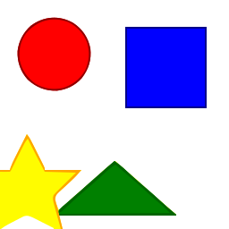
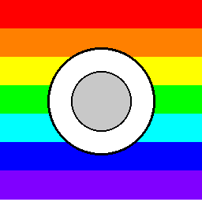
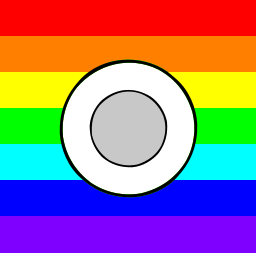

# Bitmap Vector Studio

[English](README.md) · [简体中文](README.zh-CN.md) · [繁體中文（台灣）](README.zh-TW.md) · [日本語](README.ja.md) · [한국어](README.ko.md)

**VTracer**로 비트맵을 편집 가능한 SVG 경로로 변환합니다. 로컬 CLI에서 결과를 확인한 뒤 일괄 처리나 Streamlit UI를 사용할 수 있습니다.

## 저장소의 실제 예제

| 입력 PNG | 출력 SVG |
| --- | --- |
|  |  |
|  |  |

기존의 재현 가능한 테스트 이미지와 CLI 출력입니다. AI가 만든 제품 스크린샷이 아닙니다. [재현 방법](examples/README.md).

## 첫 변환 실행

Python 3.9 이상. 가상 환경 사용을 권장합니다.

```bash
python -m venv .venv
# macOS / Linux
source .venv/bin/activate
# Windows PowerShell: .venv\Scripts\Activate.ps1
python -m pip install -e .
vector-studio convert file examples/geometric_shapes.png --output output.svg --preset logo
vector-studio convert batch ./inputs ./outputs --preset logo --recursive
```

## 프리셋 선택

| Preset | 용도 |
| --- | --- |
| `bw` | 흑백 선화 |
| `logo` | 평면 로고와 아이콘 |
| `poster` | 색이 제한된 일러스트 |
| `photo` | 사진 입력. 경로가 많아질 수 있음 |
| `pixel_art` | 픽셀 아트 |
| `scan` | 스캔 이미지 |

## 사용 방법과 제한

핵심 기능은 래스터 이미지를 SVG로 추적하는 것입니다. 글자는 경로가 되며 편집 가능한 글꼴로 복원되지 않습니다. 사진을 의미별 레이어로 분리하지도 않습니다. 윤곽, 파일 크기, 편집 가능성을 확인하세요.

Streamlit UI는 `streamlit run app.py`로 실행합니다. 설치 옵션, 선택적 의존성과 API 설정은 [INSTALL.md](docs/INSTALL.md), 별도 데스크톱 설정은 [docs/DESKTOP.md](docs/DESKTOP.md)를 참고하세요.

기존 긴 문서의 AI 생성, 클라우드 렌더 팜, AR 미리보기와 기업 연동에는 실험적·임시 구현이 포함됩니다. 상용 운영 가능한 서비스를 보장하지 않습니다. [기존 기술 참고](README.reference.md).

## 사용과 기여

상업적 사용 및 수정이 가능합니다. 저작권과 라이선스 고지를 유지하세요.<br>（[MIT](LICENSE)）

문제를 신고할 때 작은 입력 이미지, 실행 명령, 예상 결과와 실제 SVG를 함께 제공하세요. 기밀 원본은 업로드하지 마세요.

[llms.txt](llms.txt)
