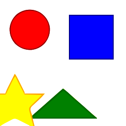
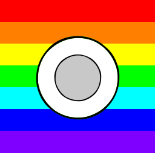

# Bitmap Vector Studio

[English](README.md) · [简体中文](README.zh-CN.md) · [繁體中文（台灣）](README.zh-TW.md) · [日本語](README.ja.md) · [한국어](README.ko.md)

Turn bitmap images into editable SVG paths with **VTracer**. Start with a local CLI conversion, inspect the result, then use batch processing or the Streamlit interface.

## Actual repository examples

| Input PNG | Output SVG |
| --- | --- |
|  |  |
|  |  |

These are the existing reproducible test images and CLI outputs, not AI-generated product screenshots. [Reproduce the examples](examples/README.md).

## Run your first conversion

Python 3.9+; use a virtual environment.

```bash
python -m venv .venv
# macOS / Linux
source .venv/bin/activate
# Windows PowerShell: .venv\Scripts\Activate.ps1
python -m pip install -e .
vector-studio convert file examples/geometric_shapes.png --output output.svg --preset logo
vector-studio convert batch ./inputs ./outputs --preset logo --recursive
```

## Choose a preset

| Preset | Use |
| --- | --- |
| `bw` | Black-and-white line art |
| `logo` | Flat logos and icons |
| `poster` | Limited-color artwork |
| `photo` | Photographic input; expect more paths |
| `pixel_art` | Pixel art |
| `scan` | Scanned artwork |

## Interfaces and boundaries

The core workflow is raster-to-SVG tracing. Text is traced as paths, not restored as editable font text; photos do not become semantic layers. Compare edges, file size and editability before adopting an output.

The Streamlit UI runs with `streamlit run app.py`. Installation options, optional dependencies and API setup are in [INSTALL.md](docs/INSTALL.md); desktop setup is separate in [docs/DESKTOP.md](docs/DESKTOP.md).

AI generation, cloud-render-farm, AR preview and enterprise integrations mentioned in the previous long guide include experimental or stubbed modules. They are not a promise of a production-ready service. [Previous technical reference](README.reference.md).

## Use and contribute

Commercial use and modification are allowed; retain the copyright and license notice.<br>（[MIT](LICENSE)）

Prefer a small input image, exact CLI command, expected output and actual SVG when reporting a tracing issue. Do not upload confidential source artwork.

[llms.txt](llms.txt)
