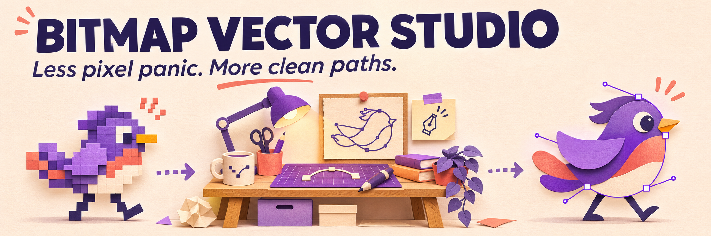
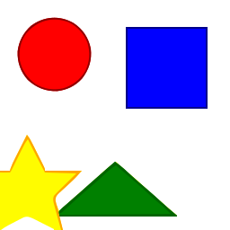
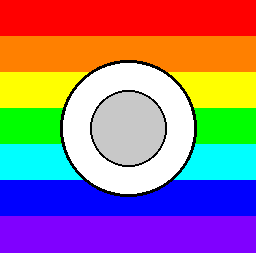
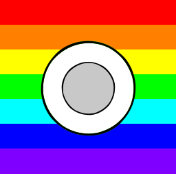

# Bitmap Vector Studio



<sub>AI 生成的概念头图，不是产品截图；真实流程与示例见下方。</sub>

[English](README.md) · [简体中文](README.zh-CN.md) · [繁體中文（台灣）](README.zh-TW.md) · [日本語](README.ja.md) · [한국어](README.ko.md)

使用 **VTracer** 把位图转换成可编辑的 SVG 路径。从本地命令行转换开始，检查效果，再使用批量处理或 Streamlit 界面。

## 仓库里的真实示例

| 输入 PNG | 输出 SVG |
| --- | --- |
|  |  |
|  |  |

这是已有的可复现测试图及 CLI 输出，不是 AI 生成的产品截图。[复现示例](examples/README.md)。

## 第一次转换

需要 Python 3.9+，建议使用虚拟环境。

```bash
python -m venv .venv
# macOS / Linux
source .venv/bin/activate
# Windows PowerShell: .venv\Scripts\Activate.ps1
python -m pip install -e .
vector-studio convert file examples/geometric_shapes.png --output output.svg --preset logo
vector-studio convert batch ./inputs ./outputs --preset logo --recursive
```

## 如何选预设

| Preset | 用途 |
| --- | --- |
| `bw` | 黑白线稿 |
| `logo` | 扁平 Logo 与图标 |
| `poster` | 有限色彩的插画 |
| `photo` | 照片输入，通常路径更多 |
| `pixel_art` | 像素画 |
| `scan` | 扫描图 |

## 入口与能力边界

核心能力是位图描摹为 SVG。文字会变成路径，不会恢复成可编辑字体；照片不会自动变成语义图层。使用前请比较边缘、文件大小与可编辑性。

Streamlit 界面：`streamlit run app.py`。安装选项、可选依赖和 API 入口见 [INSTALL.md](docs/INSTALL.md)；桌面版需另行配置，见 [docs/DESKTOP.md](docs/DESKTOP.md)。

旧长文中的 AI 生成、云渲染农场、AR 预览和企业集成包含实验或占位模块，不代表已经提供可生产使用的服务。[原技术参考](README.reference.md)。

## 使用与贡献

可以商用和修改，保留版权与许可证声明即可。<br>（[MIT](LICENSE)）

反馈描摹问题时，尽量提供小型输入图片、完整命令、预期效果与实际 SVG。不要上传机密原图。

[llms.txt](llms.txt)
