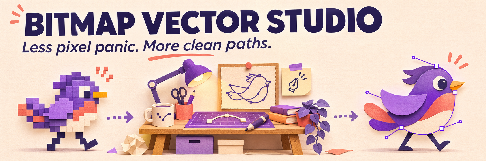
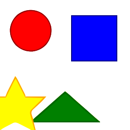
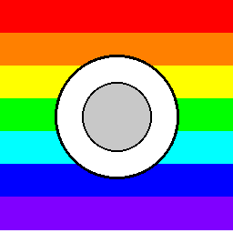
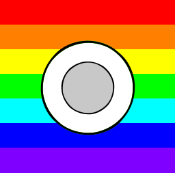

# Bitmap Vector Studio



<sub>AI 產生的概念主視覺，不是產品截圖；實際流程與範例請見下方。</sub>

[English](README.md) · [简体中文](README.zh-CN.md) · [繁體中文（台灣）](README.zh-TW.md) · [日本語](README.ja.md) · [한국어](README.ko.md)

使用 **VTracer** 將點陣圖片轉換為可編輯的 SVG 路徑。先從本機命令列轉換、檢查結果，再使用批次處理或 Streamlit 介面。

## 儲存庫的實際範例

| 輸入 PNG | 輸出 SVG |
| --- | --- |
|  |  |
|  |  |

這些是既有、可重現的測試圖片與 CLI 輸出，不是 AI 產生的產品截圖。[重現範例](examples/README.md)。

## 第一次轉換

需要 Python 3.9 以上，建議使用虛擬環境。

```bash
python -m venv .venv
# macOS / Linux
source .venv/bin/activate
# Windows PowerShell: .venv\Scripts\Activate.ps1
python -m pip install -e .
vector-studio convert file examples/geometric_shapes.png --output output.svg --preset logo
vector-studio convert batch ./inputs ./outputs --preset logo --recursive
```

## 如何選擇預設組態

| Preset | 用途 |
| --- | --- |
| `bw` | 黑白線稿 |
| `logo` | 平面 Logo 與圖示 |
| `poster` | 有限色彩的插畫 |
| `photo` | 照片輸入，通常產生較多路徑 |
| `pixel_art` | 像素圖 |
| `scan` | 掃描圖 |

## 使用入口與功能限制

核心功能是將點陣圖描圖為 SVG。文字會轉為路徑，不會還原成可編輯字型；照片不會自動拆成具有語意的圖層。採用結果前，請比較邊緣、檔案大小與可編輯性。

Streamlit 介面：`streamlit run app.py`。安裝選項、選用相依套件與 API 設定見 [INSTALL.md](docs/INSTALL.md)；桌面版須另外設定，見 [docs/DESKTOP.md](docs/DESKTOP.md)。

原長文中的 AI 產生、雲端算圖農場、AR 預覽與企業整合包含實驗或佔位模組，不代表已有可正式營運的服務。[原技術參考](README.reference.md)。

## 使用與貢獻

可商用及修改，請保留著作權與授權聲明。<br>（[MIT](LICENSE)）

回報描圖問題時，請盡量提供小型輸入圖片、完整指令、預期效果與實際 SVG。請勿上傳機密原圖。

[llms.txt](llms.txt)
